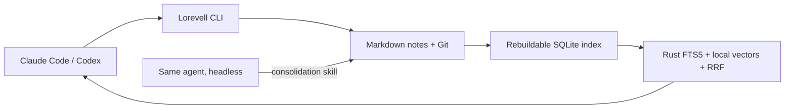

# Lorevell

**Local knowledge for humans and agents. Plain Markdown. Yours to keep.**

Keep useful knowledge in files you can read, edit and carry between tools. Link your notes, search them locally, and let your existing coding agent recall procedures or consolidate discoveries.

For Lorevell-owned vaults, Markdown is the source of truth. Read-only external recall keeps its configured source authoritative. SQLite is a disposable index. Claude Code or Codex provides the reasoning: Lorevell does not implement another agent runtime, learning model or orchestration framework.



Formerly Memori. See the [rename guide](docs/rebrand.md) for changed commands, imports and existing vaults.

## Install from this checkout

These instructions describe the breaking 2.0 interface. The branch does not publish or migrate an existing 1.x installation automatically. Python 3.9+ and a Rust toolchain are required for a source build; Python 3.13 is used in local verification.

```bash
python3 -m venv .venv
.venv/bin/python -m pip install maturin pytest
(cd lorevell-python && VIRTUAL_ENV="$PWD/../.venv" ../.venv/bin/maturin develop --release)
export PATH="$PWD/.venv/bin:$PATH"
lorevell --version
```

Local embedding inference uses AllMiniLM-L6-V2 and may download its model on first use. `--text-only` avoids model inference and supports an offline literal-search workflow.

## Start a vault

```bash
export LOREVELL_VAULT="$PWD/memory"
lorevell init
lorevell add 'Use a transaction for multi-statement writes that must succeed together.' --type procedure --tag sqlite
lorevell search 'atomic database updates'
lorevell show <id>
```

`--vault <directory>` overrides `LOREVELL_VAULT`; without either, the directory is `./memory`. `init` creates the directory, ignores caches and initializes a dedicated Git repository. It does not change your Git identity. `init --no-git` supports a plain vault; dream requires a dedicated Git repository rooted at the vault.

Each note is ordinary Markdown:

```markdown
---
id: retry-procedure
type: procedure
tags: [http, debugging]
---
# Retry a transient request

Honor Retry-After. Otherwise use bounded backoff with jitter.
Automatically retry only idempotent operations.

## Related
- [[rate-limit-investigation]]
```

`add` generates a UUID and filename. Files can be renamed or organized into subdirectories without changing their IDs. To write multiline procedures, use `add --file body.md` or `add -` with stdin. Unknown frontmatter fields are preserved; `id` is required, while `type` and `tags` are optional. Every active `.md` file must have valid frontmatter and a nonempty body.

## Find a lesson in the browser

```bash
lorevell --vault ./memory ui
# Choose another port, or leave browser opening to yourself:
lorevell --vault ./memory ui --port 0 --no-open
```

The local workspace opens in Brave on macOS and the default browser elsewhere. Search for a past lesson, read its Markdown and source path, follow linked notes or backlinks, then copy the Markdown or a command block to reuse it. **Keyword** is the offline default; **Hybrid** adds local semantic search and may download the embedding model on first use. Switch modes explicitly, and use the note-type filter to narrow results.

**New note** saves a real Markdown file in the selected vault. External edits are picked up on the next search or refresh. The UI uses the same Rust retrieval engine as the CLI; it does not generate answers or add another database. It binds only to `127.0.0.1`; leave it on loopback. Stop the server with Ctrl+C. See [the workspace guide](docs/local-workspace.md) for scope and limitations.

The [vault benchmark report](docs/benchmarks/README.md) records native, CLI and HTTP latency, CPU, memory, concurrency and storage measurements at 25–1,000 linked notes, with reproducible before/after data and retrieval-quality checks. First-time embedding work remains separate from warm recall latency.

## Recall and maintain

| Command | Behavior |
| --- | --- |
| `add <body>` / `add --file <path>` | Write a new atomic note; no semantic overwrite |
| `update <id> --content <body>` | Replace the body, preserving its stable ID |
| `update <id> --meta '{"verified":true}'` | Merge top-level frontmatter fields |
| `search "query" --limit 5 --graph-limit 3` | Hybrid matches plus at most three extra one-hop notes |
| `show <id> --limit 5` | Source note, outgoing links, backlinks and unresolved links |
| `ui [--port 8765] [--no-open]` | Open the local search, source-reading and capture workspace |
| `index` | Incrementally synchronize hashes, embeddings and links from Markdown |
| `review --limit 3` | Inspect a bounded revision-aware review queue; explicitly mark or defer after checking evidence |
| `recall "query" --snapshot <file> --cache-dir <private-directory>` | Read-only source recall with provenance; another system retains authority |
| `archive <id>` | Preserve the original bytes in `archive/`; remove it from active retrieval |
| `delete <id>` | Alias for archive, not permanent deletion |
| `setup --agent codex --project .` | Install learning and dream skills under `.agents/skills/` |
| `setup --agent claude --project .` | Install the same skills under `.claude/skills/` |
| `dream --agent codex` | Run bounded consolidation with the installed headless runtime |

`--json` emits structured output, with errors on stderr and a nonzero exit. IDs accept unique prefixes. `--type` filters search; `--min-similarity` gates raw cosine on the semantic leg, while literal matches remain eligible. The returned ranking score is not confidence or factual truth.

Wiki links resolve by exact stable ID, then vault-relative filename without `.md`, then unique basename. `[[path/note#heading|label]]` is supported. Links in fenced blocks and ordinary inline code are ignored. Backlinks are derived; there is no second file write for each relationship. Missing or ambiguous targets are diagnostics, not invented edges. Graph context is explicit one-hop navigation and is returned separately from ranked matches.

Human edits become searchable after `index`; CLI reads and mutations also synchronize automatically. Native `Vault` / `PyVault` callers explicitly call `index` after mutations or external edits before querying links or search. The index lives in `.lorevell/index.sqlite`. Close other Lorevell processes and remove that cache to rebuild it from files. Hidden directories, symlinks and the root `archive/` directory are excluded. Malformed active notes or duplicate IDs abort indexing and preserve the prior cache.

## Let the agent learn

Run `setup` in the project where the agent works. The shared skill asks it to search before investigating, then retain one or two verified reusable lessons after a meaningful discovery. Routine work can save nothing. Commands, their preconditions and evidence belong in ordinary procedure notes. No automatic session recording, transcript ingestion or skill generation is involved.

Skill installation refuses to overwrite customized instructions unless `--force` is explicit. The canonical files are [skills/lorevell](skills/lorevell/SKILL.md) and [skills/dream](skills/dream/SKILL.md); identical packaged copies support installed wheels.

For personal or shared memory owned by another system, use [read-only snapshot recall and bounded review](docs/memory-integration.md). An existing adapter can provide a complete eligible cache snapshot over stdin; Lorevell supplies local retrieval without taking over cloud synchronization or writes. Sync freshness and semantic verification remain separate.

## Consolidate with an existing headless agent

```bash
# Configure a Git identity normally if this machine has none.
lorevell dream --agent codex --dry-run
lorevell dream --agent codex --max-notes 20 --timeout 300
# Or use an installed Claude Code CLI:
lorevell dream --agent claude
```

A dream run processes a bounded batch of files changed since the last successful run. Lorevell snapshots pending knowledge in Git, invokes one agent, validates/reindexes its edits, and commits the result. The agent improves notes, extracts useful procedures, repairs links and flags uncertainty. Superseded originals must remain in `archive/` or a byte-preserving rename. Validation checks structure, scope and retained originals; it cannot prove semantic truth.

Failures and timeouts leave edits available for inspection and do not acknowledge the batch. Pending batches remain pending. `.lorevell/dream-last.log` records the child output locally. Concurrent dream runs are rejected. Run no other writers during consolidation: the MVP does not merge concurrent native edits.

Successful changes are reversible with `git -C "$LOREVELL_VAULT" revert <consolidation-commit>`, followed by `lorevell index`. There is no scheduler service; invoke the command manually or through a scheduler you choose and authorize. Runtime authentication and normal agent permissions remain the responsibility of the existing installed CLI. A Codex sandbox must have writable access to the chosen vault because recall refreshes its index; for an external vault, pass that exact directory with Codex’s normal `--add-dir` option. Lorevell never passes bypass-permission flags.

## Try the maintainer knowledge demo

This public project is also a real Lorevell vault example. After installing from this checkout:

```bash
export LOREVELL_VAULT="$PWD/.venv/demo-vault"
lorevell init
cp docs/evals/real-project/before/*.md "$LOREVELL_VAULT/"
lorevell index
lorevell search "How do I undo a consolidation and refresh search?"
python scripts/eval-project.py --vault "$LOREVELL_VAULT" \
  --questions docs/evals/real-project/questions.json
```

The example has 24 source-grounded maintainer notes and 20 frozen questions. It measures ranked relevant note IDs, not generated-answer accuracy or general product quality. [The real-project report](docs/release-verification.md) records learning and recall in separate authenticated Codex sessions, consolidation, rollback, retrieval results and limitations.

## Architecture and verification

- [2.0 design and implementation plan](docs/plans/memori-v2.md)
- [Operational details and limits](docs/v2.md)
- [Live acceptance evidence](docs/v2-verification.md)
- [Eval-gated improvement loops](docs/evals/loops/README.md)
- [Measured CI cache improvement](docs/evals/loops/ci-cache.md)
- [Relevance semantics](docs/relevance.md)
- [Native engine time semantics](docs/freshness.md)

```bash
cargo fmt --all -- --check
cargo clippy --workspace --all-targets -- -D warnings
cargo test -p lorevell-core --release
cargo test -p lorevell-core --no-default-features --release --test vault_test --test relevance_test --test freshness_test
python3 scripts/sync-skills.py --check
PATH="$PWD/.venv/bin:$PATH" .venv/bin/python -m pytest lorevell-python/tests -v
```

Tests use real temporary files, SQLite, the native extension and CLI subprocesses. Launcher contract tests use controlled child processes; actual headless Codex runs and the small held-out retrieval experiment are recorded separately. A passing structural check is not proof of autonomous semantic correctness.

## Breaking changes

2.0 replaces `--db`, `store`, the old multi-section `context`, setup snippet and dashboard with the vault-first interface. It never reads or modifies `~/.claude/lorevell.db`. Export important 1.x records using the 1.x binary before switching, then turn selected records into atomic Markdown notes; an automatic migration is not included. The old low-level `Lorevell` / `PyLorevell` database engine remains as retrieval plumbing, not as an alternative canonical store for 2.0 vaults.

MIT licensed. No graph database, hosted vector store, custom LLM API or orchestration framework is required.
