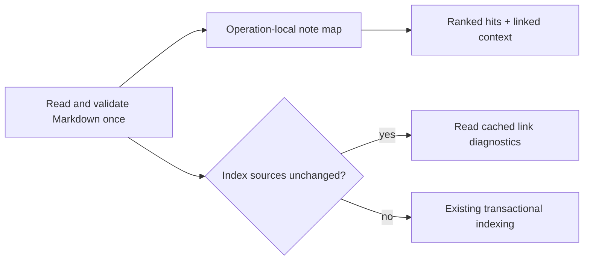

# Vault recall performance

Raw measurements in `baseline.json` are from the merged `c5e8c76` wheel. `scripts/bench-vault.py` runs the actual native vault, CLI subprocesses and loopback HTTP server against disposable linked Markdown fixtures.

The host is an Apple M6 with 16 GiB RAM and 12 logical CPUs, macOS 27.0.1, CPython 3.13.18. Sequential baseline/candidate runs use the same machine and interpreter version. Background work and OS caches are not controlled, so results are observations rather than service-level guarantees.

Five samples support only a coarse nearest-rank p95 (the maximum observed sample), not a reliable tail-latency estimate. Initial indexing, first query and four-request concurrency batches have one observation each. CPU is user + system time for the process and children, covering HTTP threads and CLI children. RSS is sampled using `ps`; peak RSS uses `getrusage`. These are process totals, not per-note allocation measurements. HTTP measures server + loopback + JSON, not browser paint or clipboard behavior. Model files are already cached: first use includes model initialization and corpus inference, but not network downloads. The OS file cache is not evicted.

Fixtures contain roughly 1 KiB per note, three outgoing links and three backlinks. Every twentieth note contains the keyword `quasar`; all contain `transactions`. This tests selective and broad queries, graph expansion, listing, refresh, single-file edits and concurrent requests. It does not represent every vault's link density, note length or query distribution.

Reproduction (from the repository root, with an installed wheel in the selected environment):

```bash
/path/to/python scripts/bench-vault.py --sizes 25,250,1000 --samples 5 --hybrid --label revision --out results.json
```

Use different environments for baseline and candidate wheels. Run from the same directory to reuse the same model cache. The script never touches a user's vault. `ps` and Unix resource accounting are required for this harness; they are not runtime dependencies of Lorevell.

## Results

| Notes | Warm HTTP keyword p50 / p95 | Warm HTTP hybrid p50 / p95 | Native broad keyword p50 |
| --- | --- | --- | --- |
| 25 | 7.86 / 8.00 → 1.10 / 1.22 ms | 160.84 / 161.62 → 3.38 / 3.90 ms | 155.74 → 0.94 ms |
| 250 | 765.15 / 774.75 → 8.36 / 8.45 ms | 2556.70 / 2577.47 → 10.22 / 10.75 ms | 2478.60 → 4.25 ms |
| 1000 | 10867.82 / 11727.51 → 33.10 / 33.43 ms | 10945.28 / 11183.47 → 37.50 / 37.99 ms | 10942.28 → 16.36 ms |

At 1,000 notes, warm HTTP keyword p50 improves 328× and hybrid p50 292×. Four simultaneous keyword requests complete in 131 ms instead of 42.86 seconds: observed throughput rises from 0.093 to 30.5 requests/second. This server still serializes vault work; these numbers do not establish multi-user scalability.

Mean CPU time per 1,000-note HTTP keyword request falls from 10,865 ms to 33 ms. Unchanged index p50 drops from 38.94 to 17.08 ms. Fresh CLI keyword p50 drops from 1,400 to 57.76 ms; interpreter/process startup still costs tens of milliseconds.

First hybrid indexing remains expensive: 10.49 → 9.88 seconds at 1,000 notes; the single 250-note observation is slower (2.10 → 2.87 seconds). No initial-model/corpus throughput improvement is claimed. The 25-note candidate CLI sample also contains a 328 ms outlier versus a 25 ms median; the raw samples retain it.

A sequential 20-sample, 25-note keyword-only follow-up retains the original first-launch outlier and adds independent data: CLI p50/p95 is 30.28/34.44 ms before and 22.72/23.99 ms after. See `followup-baseline.json` and `followup-candidate.json`. This does not identify the cause of the original 328 ms first-launch sample.

### The three fixes

1. **One fresh note map per retrieval operation.** Search/show reuse parsed Markdown across hits and linked neighbors. The 40-result linked fixture previously caused 320 full source scans; it now causes one. The map is dropped at the end of each call. External edits and malformed notes are still observed on the next operation; there is no TTL, watcher or cross-request file cache.
2. **Compile the wiki-link regex once.** The pattern and parsing semantics are unchanged. At 1,000 notes, source-listing p50 falls from 33.01 to 16.21 ms. This removes repeated regex compilation without another dependency or persistent data structure per vault.
3. **Keep unchanged indexing read-only.** Validate and hash the complete active source set, compare IDs, hashes, paths and required vector presence, then read existing link diagnostics when nothing changed. Native SQLite `PRAGMA data_version` proves no commit occurs on this path. Renames, newly resolved links, removals and missing-vector backfill still take the normal indexing path.



### Memory, disk and payloads

Process memory is not materially reduced. At 1,000 notes, keyword peak RSS is 45.9 → 46.4 MiB, and hybrid peak is 262.1 → 278.6 MiB (about 6% higher in this pair). The model dominates peak memory. Sampled resident memory varies substantially with allocator/OS reclamation and process duration; use the raw phase samples rather than interpreting them as a retained-note-cache improvement. The operation-local map uses O(vault size) memory and is not retained between requests.

Markdown byte counts are identical. Response sizes are effectively unchanged (catalog is capped at 500 summaries). Live SQLite + journal size varies with WAL checkpoints: at 1,000 notes it is 9.85 → 12.38 MB in these runs, despite fewer unchanged writes. This is not a disk-space reduction claim or a vacuumed database comparison; smaller runs have smaller live journal footprints after the fix. Persistent/checkpointed storage requires a separate controlled comparison.

### Correctness and scope

Frozen main (20 questions) and shadow (10 questions) reports are exactly identical before/after in both keyword and hybrid modes, including returned ID order and all quality metrics; see `quality.json`. Main top-1 stays 18/20; shadow top-1 stays 9/10. Benchmark selective keyword IDs also match at every scale. These small acceptance sets do not establish relevance for arbitrary knowledge bases.

Regression tests cover live external edits, full-file validation, exact IDs/prefix ambiguity, read-only index behavior, rename-sensitive links, newly resolved targets and removals. Existing tests cover malformed inputs, symlinks, atomic indexing, metadata filters and bounded graph expansion.

Remaining candidates, deliberately deferred: bounded embedding batches (measure peak memory and ranking first), eliminating duplicate UI bootstrap/catalog refreshes, and reducing duplicate validation between HTTP indexing and retrieval. File watchers, persistent parsed-note caches, extra databases and ANN indexing are unnecessary for the measured 1,000-note hot path.
