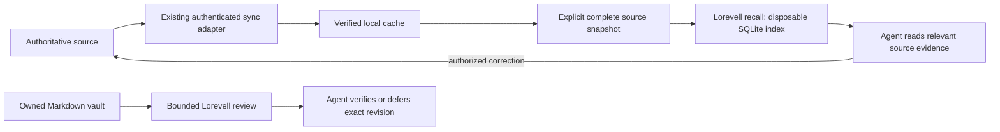

# Memory lifecycle and external-source recall

Lorevell can supply local recall and bounded review without taking ownership of another system's knowledge or authentication. The product reuses its Rust SQLite/FTS5/embedding engine; reasoning and semantic verification remain with the existing agent.



## What transfers from a personal memory workflow

| Mechanism | Lorevell implementation | Boundary |
| --- | --- | --- |
| Source authority and provenance | Read-only snapshot recall with source URL/revision | Writes stay with the source's existing workflow |
| Sync freshness distinct from truth | Adapter supplies sync status; review requires an evidence decision | Neither indexing nor a matching hash verifies facts |
| Bounded, fair maintenance | `review --limit 3`, oldest/unattempted first | Heuristic triage; no automatic semantic rewriting |
| Revision-safe acknowledgements | Exact note + watched-source revision on mark/defer | A changed revision wakes a deferred item |
| Drift detection | Explicit file watches store hashes, not source contents | No filesystem crawl or scheduler |
| Evidence preservation | Immutable-source dream exclusions/validation and claim-coverage instructions | Git/scope checks cannot prove semantic losslessness |
| Forget-aware local recall | Complete snapshots replace a disposable projection; no archived projection copies | Source deletion and backup erasure belong elsewhere |

Notion schemas, a particular user's sync outbox, personal paths, credentials, daily schedules and cloud-specific conflict logic stay outside Lorevell. The source adapter decides what is eligible and whether a remote reconciliation completed.

## Read-only source snapshots

```bash
lorevell recall "retry requests" --snapshot snapshot.json --cache-dir ./private-recall-cache --text-only
lorevell recall --snapshot snapshot.json --cache-dir ./private-recall-cache --index-only --json
```

Use `--snapshot -` for stdin so an adapter need not write another content-bearing manifest. `--text-only` avoids model inference; hybrid recall uses existing local embeddings and may download the model on first use. `--index-only` refreshes the text projection without inference. A zero limit returns no matches and avoids inference.

```json
{
  "version": 1,
  "source_id": "my-approved-source",
  "complete": true,
  "sync_status": "current",
  "synced_at": "2026-11-12T00:00:00Z",
  "records": [{
    "id": "retry-procedure",
    "title": "Retry transient requests",
    "content": "Honor Retry-After; retry only idempotent operations.",
    "source_url": "https://example.test/notes/retry",
    "source_revision": "revision-42",
    "updated_at": 1760000000
  }]
}
```

`complete: true` means the adapter enumerated **all currently eligible records for this projection**. It is separate from cloud sync freshness: an offline/partial source can still provide a complete local projection of its last verified eligible cache. An incomplete inventory is rejected before cache mutation. `sync_status` is `current`, `partial` or `offline`, asserted by the adapter and returned unchanged; Lorevell does not attest it. Keep source revision, sync date and semantic verification distinct.

IDs must be unique safe strings (letters/digits/underscores/hyphens, up to 128 characters). Source ID, title, content, URL and revision are required. `updated_at` is a required finite nonnegative timestamp from the source, not the import time. An adapter must supply a known source clock rather than silently refreshing old knowledge at import time. `source_path` optionally points to the existing verified cache for inspection. Records are read-only; recall exposes no source-write or dream operation and adds no graph edges from inferred relationships.

The private cache must be a new/empty dedicated directory. Source ownership is recorded; another source or an existing vault is rejected. Changing the eligible records/revisions discards the previous projection before rebuilding. Rebuild failure returns an error instead of serving removed stale records; retry from a complete snapshot. The canonical source is never changed. Losing the SQLite cache causes a rebuild. OS locks serialize callers. Cache cleanup is not cryptographic erasure, and no claim is made about filesystem backups. A caller must always supply a current eligible snapshot; do not reuse a pre-forget manifest.

## Bounded review of an owned vault

```bash
lorevell --vault ./memory review --limit 3
lorevell --vault ./memory review --defer <full-id> --revision <revision>
lorevell --vault ./memory review --mark <full-id> --revision <revision>
lorevell --vault ./memory review --watch ./Makefile --note <full-id>
```

A scan returns candidate paths, exact revisions, reasons and the remaining count. Review the actual evidence before marking. Mark/defer reject stale revisions, including changed explicitly watched source files. Deferral cools the same revision for 24 hours; a change wakes it immediately. `review_after_days` can set a 1–3650 day interval in frontmatter; the default is 90 days, a triage policy rather than expiration. No note is deleted or declared false because of age.

The 800-word and exact duplicate-passage checks prompt inspection only. Notes marked `immutable_source: true` are evidence, exempt from shortening prompts and dream candidates. Dream rejects changes to originally protected active notes before committing or advancing its checkpoint. As with other failed runs, edits remain inspectable, with original bytes in the baseline Git snapshot; restore them through normal Git recovery. The launcher is not a sandbox against all possible agent actions.

Watches are explicit local paths and hashes. After checking a changed source's claim, update its watch baseline, scan again, then mark the returned revision. Synchronizing a file or updating a watch is not a semantic review. Review state lives under the vault's ignored `.lorevell/` directory; losing it causes reinspection, not knowledge loss.

## Adapter separation

A personal `$memory` integration can keep Notion authoritative, reconcile through its existing approved tools, then pipe only verified, non-suppressed cache records to `recall`. Source documents remain original evidence. Local-only notes, secrets, raw conversations and unapproved files stay out of the snapshot. Corrections go back through the authoritative source workflow, followed by readback, cache refresh and projection refresh. On explicit forgetting, clear derived recall copies before suppression/sanitization, then rebuild from eligible sanitized records. Adapter failures must remain visible; use the authoritative source or verified cache as a fallback.

The repository tests use synthetic sources. Personal adapter code, private cache contents and account-specific configuration are not bundled with Lorevell.
