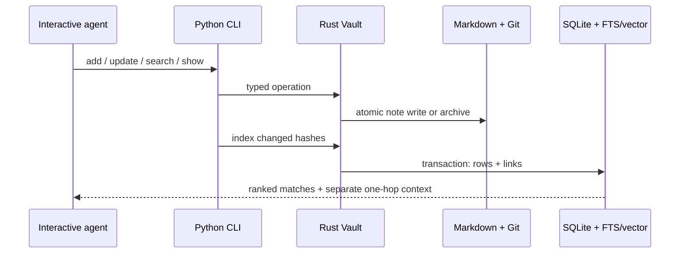
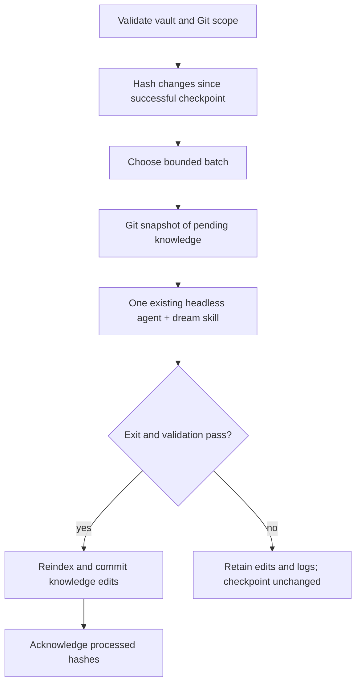

# Lorevell 2.0: operational design

## Ownership



`lorevell-core/src/vault.rs` is the filesystem-to-index seam. It uses the existing core search implementation, not a second retrieval stack. `PyVault` exposes that seam through PyO3. `Lorevell` and `PyLorevell` remain low-level engine interfaces for consumers and tests; application code uses `Vault` / `PyVault` when Markdown must be authoritative.

A vault contains:

```text
memory/                    # dedicated Git repository for dream
├── <id>.md                # active notes, or human-chosen relative paths
├── archive/               # original evidence, excluded from active search
├── .gitignore
└── .lorevell/               # ignored, local/rebuildable state
    ├── index.sqlite       # memories, source hashes, explicit links
    ├── vault.lock         # OS lock released when the process exits
    ├── dream.lock         # one consolidation at a time
    ├── dream-state.json   # acknowledged hashes; loss causes reinspection
    └── dream-last.log     # child stdout/stderr; not committed
```

## Notes and indexing

The frontmatter is a YAML mapping convertible to JSON. IDs are strings of letters, digits, `_` and `-` (maximum 128 bytes). `type` is an optional string; `tags` is an optional string list. Generated notes include numeric epoch-second `created_at` / `updated_at`; other fields survive edits. Explicit timestamps must be finite numbers. Body content includes code blocks and remains ordinary Markdown.

Indexing validates the complete active file set before opening its update transaction. A changed hash replaces that note's derived row; an unchanged hash avoids regeneration unless embeddings are missing and requested. Removed/archived source IDs are removed from the active index. Link resolution is recalculated so renames or newly created targets can repair previously unresolved links. A failed indexing transaction preserves the previous cache. An atomic file write can succeed before a later indexing error; the note stays authoritative and can be repaired/reindexed.

The SQLite base engine schema remains v4. Vault-specific `note_sources(note_id, path, hash)` and `note_links(source_id, target, target_id)` are cache tables initialized alongside it. No index row is a substitute for a source note. Close connections before removing the cache, particularly on Windows.

Lorevell mutations and index passes acquire a cross-process OS lock. External editors do not participate in that lock. Avoid concurrent native edits while a write or dream is in progress. This MVP does not provide filesystem transactions spanning multiple notes, an editor watcher or a conflict-merge service.

## Retrieval and graph boundaries

CLI search synchronizes files, then uses the original Rust hybrid retrieval: FTS5 literal candidates, MiniLM semantic candidates, age/use-adjusted sub-ranks and RRF. FTS tokenization is literal, not a boolean query language. `--text-only` avoids inference. A semantic floor is optional and does not exclude literal hybrid matches.

Wiki links resolve by stable ID, exact vault-relative filename, or unambiguous basename, in that order. Anchors and display aliases are ignored for target resolution. This lightweight parser recognizes ordinary fenced blocks and inline code; it is not a full Obsidian/Markdown parser. Backlinks need no reciprocal file modification. Archive citations can remain ordinary Markdown links; archived evidence does not re-enter active retrieval through graph expansion.

Search returns `matches` and a separate `context` list. `graph_limit` is a total extra-note budget across all seeds, not a budget per seed. Context is limited to outgoing links and backlinks, deduplicated and filtered by supplied flat metadata equality. It is not recursively expanded or assigned an invented semantic score. `show` independently bounds each outgoing/backlink list.

## Dream transaction boundary



Dream requires a dedicated Git repository at the vault root, avoiding accidental commits from a parent source repository. Non-knowledge dirty files must be committed or resolved first. An initial `.gitignore` can join the baseline snapshot; later agent edits are limited to non-hidden knowledge `.md` paths. The launcher refuses a successful result if the child changed Git history, changed non-knowledge files, exceeded the mutation count, removed original bytes without retaining them, or left an invalid active vault.

Existing archive files are immutable during a dream run: deletion, renaming or byte changes reject the batch. New archives can preserve superseded active notes. Index diagnostics are compared by stable source ID and unresolved target before committing; new missing or ambiguous links reject the batch, while preexisting unresolved links do not prevent unrelated maintenance or source renames. Rejected edits remain inspectable and the dream checkpoint does not advance.

The checkpoint acknowledges selected candidates and actual changed paths only; other changed notes remain pending. Candidates combine changed paths with the complete revision-aware review queue before applying the batch limit. This avoids starving entries beyond the review CLI's default page. Immutable sources remain excluded. Unchanged notes under an explicit review deferral stay deferred.

Successful dream runs checkpoint maintenance attempts separately from evidence reviews: source revision fingerprints and attempt times throttle repeat inspection until `review_after_days`, while new note/source revisions can wake maintenance earlier. They never write `review.json` review acknowledgements or rebaseline source watches. This means a successful dream can flag uncertainty while the evidence-review queue still correctly reports it unresolved. Old hash-only checkpoints remain valid and start a bounded maintenance pass.

The checkpoint is an optimization stored outside Git, not canonical knowledge. Removing it causes notes to be considered again. A failed process, timeout or validation error does not advance hashes or maintenance attempts. A crash after commit but before checkpoint can cause a harmless repeat review.

The launcher uses `codex exec --sandbox workspace-write` with non-interactive approval policy, or `claude -p` with native file tools and a turn bound. It never disables permissions. Runtime setup, account access and model configuration belong to those CLIs. Structural checks do not constrain all possible agent actions or prove retained meaning; use trusted notes, inspect the diff and do not write concurrently. [Codex non-interactive mode](https://learn.chatgpt.com/docs/non-interactive-mode) and [Claude programmatic mode](https://code.claude.com/docs/en/headless) document the underlying entry points.

## Intentionally absent

No automatic recording or transcript ingestion; no custom extraction/classification model; no learned retrieval weights or LLM reranker; no graph database; no multi-agent orchestration; no scheduler; no skill auto-generation. Routine work can produce zero notes. Intelligence stays in the existing interactive or headless agent.
